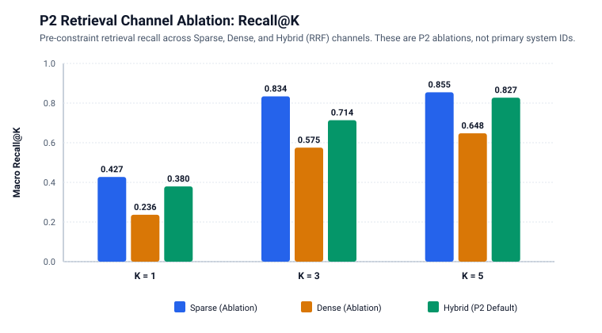
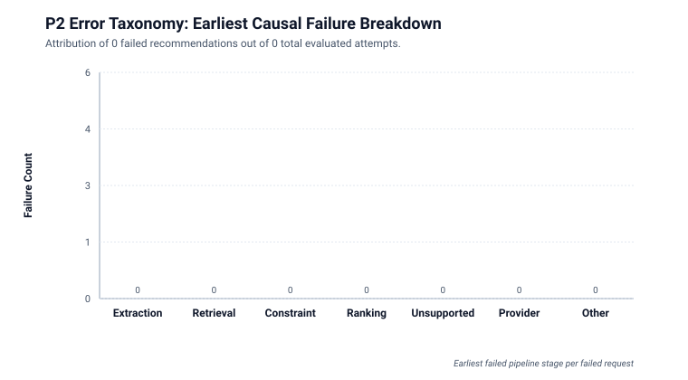
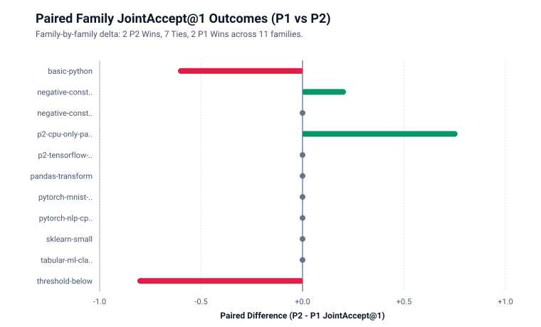
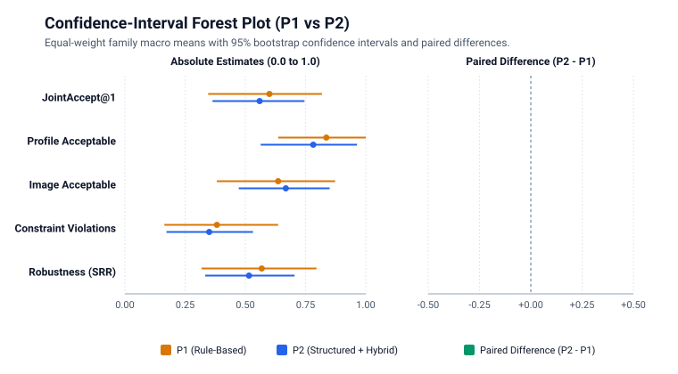

# Protocol-v5 Offline Research Report: E1 (Quality) & E2 (Robustness)

**Protocol Version**: `5.0.0` | **Generated UTC**: `2026-10-13T08:44:42.723208Z` | **Git Revision**: `9f513666ea`

---

## 1. Primary Recommendation Quality (E1: P1 vs P2)

| Metric | P1 (Rule-Based) | P2 (Proposed) | Difference (P2 − P1) | p-value |
| :--- | :--- | :--- | :--- | :--- |
| **JointAccept@1** | 60.0% [34.5%, 81.8%] | 55.9% [36.4%, 74.5%] | N/A | 0.8750 |
| **Profile Acceptability** | 83.6% [63.6%, 100.0%] | 78.2% [56.4%, 96.4%] | N/A | 1.0000 |
| **Image Acceptability** | 63.6% [38.2%, 87.3%] | 66.8% [47.3%, 85.0%] | N/A | 0.7500 |
| **Constraint Violations** | 38.2% [16.4%, 63.6%] | 35.0% [17.3%, 53.2%] | N/A | 0.7500 |
| **Unsupported Detection** | 0.0% [0.0%, 0.0%] | 100.0% [100.0%, 100.0%] | N/A | N/A |
| **Latency (seconds)** | 0.000 [0.000, 0.000] | 1.508 [1.440, 1.586] | N/A | < 0.001 |

> *Notes: Point estimates report workload family macro-averages with 95% percentile bootstrap confidence intervals in brackets. Differences are computed as P2 minus P1. Latency is measured end-to-end per execution.*

---

## 2. Robustness Table (E2)

| System | Canonical | Paraphrase | Vietnamese | Noisy | Code-Centric | Overall SRR (Macro) | Worst-Case Family Robustness |
| :--- | :--- | :--- | :--- | :--- | :--- | :--- | :--- |
| **P1** | 0.0% N/A | N/A | 0.0% N/A | N/A | N/A | **56.8% [31.8%, 79.5%]** | 0.0% |
| **P2** | 100.0% N/A | N/A | 100.0% N/A | N/A | N/A | **51.5% [33.3%, 70.5%]** | 0.0% |

> *Notes: Overall SRR (Semantic Robustness Rate) is the equal-weight family macro mean across non-canonical reviewed-equivalent variants. Worst-case family robustness measures the fraction of families where all tested equivalent variants succeeded.*

---

## Figures and Visualizations

### Figure 1: P2 Retrieval Channel Recall@K Ablation

### Figure 2: P2 Earliest-Failure Taxonomy

### Figure 3: Paired Family JointAccept@1 Outcomes

### Figure 4: Confidence Interval Forest Plot

---

## 3. P3 Development Gate Decision Report

> [!WARNING]
> **P3 Development Gate Decision: `NOT_RETAINED`** (Source: `evaluated_split`)
> Predefined development gate evaluated 5 eligible families. Observed 0 ranking-error families (0.0% of eligible families). Gate decision is 'NOT_RETAINED'.

> [!IMPORTANT]
> **CONFIRMATORY ISOLATION ACTIVE**: Confirmatory observations are strictly isolated and did not influence the P3 development gate decision.

### Predefined Reranking Headroom Criteria

- **Minimum Ranking-Error Families Required**: `3`
- **Minimum Ranking-Error Fraction Required**: `5.0%`

### Observed Development Evidence

- **Eligible Workload Families**: `5`
- **Observed Ranking-Error Families**: `0`
- **Observed Ranking-Error Rate**: `0.0%`
- **Total Ranking-Error Attempts**: `0`

---

## 4. Automatic Limitations & Provenance Block

- **Independent Workload Families ($N$)**: `18`
- **Total Prompt Variants Evaluated**: `83`
- **Dataset Split**: `v5-development` (Role: `development`)
- **Dataset Canonical SHA-256**: `079ca97e88719b2e...`
- **Claims Permitted**: `NO (Formative/Development Evidence Only)`
- **Fallback Invocations**: `0`

### Missing Evidence & Completeness Status

- *No missing evidence: all planned offline evaluation cells for E1/E2 were executed and validated.*

### Unexecuted Experimental Conditions

- E3 (B0 vs P2 Real Human Usability Study): NOT_EXECUTED in offline harness
- E4 (Resource Efficiency & Live Cluster Execution): NOT_EXECUTED in offline harness
- E5 (Image Correctness & Multi-Node Image Storage): NOT_EXECUTED in offline harness

### Machine-Readable Statistical Statements

- *No confirmatory hypothesis tests meet significance thresholds.*

### Claim Boundary Constraints

- Workload FAMILY is the semantic independent unit; variants and repeats do not inflate N.
- Never claim general superiority unless Holm-adjusted p < 0.05 and confidence intervals strictly exclude zero.
- B0 does not generate rankings; MRR/nDCG/Hit@K are prohibited for B0.

